# `agy-board` 后续演进路线图与开发实施指南

> **基线提交**：`2debb49`（`agy-board`）
> **生成日期**：2026-11-25
> **核心定位**：`agy-board` 不是传统“人记 → 人做”的个人 To-Do 清单，而是嵌在 Antigravity Agent Harness 中的 **「AI 暂存箱 → 人类开干前审校闸门 → 跨会话交接胶囊 → 隔离派发与定时调度台」**。

---

## 1. 产品定位与开源标杆参考（2026-11-25 实测活跃度）

在 Agent Harness 场景下，绝大部分待办由 **AI 中途入箱（暂存）**、**人做开干前审校/改写**、**AI 带着提纯上下文在干净会话开跑**、**人类在 `需要你确认` 验收或留痕接续**。本路线图综合了以下高星且仍在高频维护的开源/标杆项目逻辑（均经 GitHub API 于 2026-11-25 核验活跃度）：

| 标杆项目 / 产品 | 仓库 / 指标（2026-11-25） | 最值得 `agy-board` 借鉴的核心机制 |
| :--- | :--- | :--- |
| **`gastownhall/beads`** （原 `steveyegge/beads`） | 29.0k★ · 2026-11-24 Push | **跨会话记忆图谱 + `discovered-from` 溯源**：任务不仅记录状态，还记录它从哪次探索/任务衍生而来；防止聊天压缩后忘记“为什么记下它”。 |
| **`MrLesk/Backlog.md`** | 7.5k★ · 2026-11-24 Push | **四段式结构化交接工单 + 三道人类闸门**：强制拆出 `背景 / 可勾验收标准(AC) / 执行前计划 / 交接笔记`，人审计划后以「1 任务 = 1 干净上下文窗口」派发。 |
| **`BloopAI/vibe-kanban`** | 28.8k★ · 2026-11-15 Push | **看板即 Worktree 调度台**：拖入执行列自动分配独立 Git Worktree 启动 Agent；完成后自动进 `In Review` 展示 Diff，留追问意见自动打回续跑。 |
| **`Fission-AI/OpenSpec` / `github/spec-kit` / `coleam00/Archon`** | 75.6k★ / 151.3k★ / 24.0k★ · 2026-11-24 Push | **审核左移（Shift-Left）与人类决策闸门**：AI 起草提案后停在人类审校门前，等你改字拍板才允许执行。 |
| **Things 3 / Linear / Super Productivity / Claude Cowork / Raycast** | 商业标杆 & 24k★ OSS | **严格分离 `When(推迟/调度)` 与 `DDL(硬截止)`**；List 专攻多维盘点与批量操作；桌面休眠错峰后最多补跑 **1 次**并显式提示 `试跑 / 跳过`。 |

> **筛选说明**：曾对比过的 `AndyMik90/Aperant`（原 `Auto-Claude`，14.6k★，停更于 2026-06-14）与 `eyaltoledano/claude-task-master`（28.5k★，停更于 2026-04-28）均已数月未维护，仅作历史设计参考，不作为活跃跟随对象。

---

## 2. 优先级总览矩阵

| 编号 | 优先级 | 主题 | 解决的核心痛点 | 关键后端文件 | 关键前端/规则文件 | 预估工作量 |
| :--- | :---: | :--- | :--- | :--- | :--- | :--- |
| **P0-1** | **P0** | AI 暂存草稿闸门（`Draft`）与来源溯源（`discovered-from`） | AI 顺手塞进的待办和人审过的待办混在一起；不知从哪个会话衍生而来 | `src/core/types.ts` `src/host/db.ts` `src/entry/mcp.ts` `src/host/board-service.ts` | `src/client/components/TaskDetailDrawer.tsx` `rules/AGENTS.md` `skills/agy-board/SKILL.md` | 0.5 天 |
| **P0-2** | **P0** | 跨会话「上下文胶囊」与关联会话结论权重（`★ 纳入交接`） | 关联多个会话后时间一长忘了哪个重要；老会话续写导致 Context Rot | `src/host/db.ts` `src/core/types.ts` `src/core/session-reuse.ts` `src/host/board-service.ts` | `src/client/components/TaskDetailDrawer.tsx` `src/client/api.ts` | 0.5–1 天 |
| **P0-3** | **P0** | 修复后台定时调度状态机 3 个致命 Bug | 点`验收通过`误杀 `cron`；覆盖未验收成果；电脑休眠 >5 分钟静默丢任务 | `src/core/types.ts` `src/core/schedule.ts` `src/host/board-service.ts` `src/host/scheduler.ts` | `src/client/api.ts` | 0.5 天 |
| **P1-1** | **P1** | 三视图功能逻辑彻底分化（`焦点` vs `看板` vs `列表`） | 三个视图吃同一份全量数组、语义高度重合；缺今日聚焦、拖放派发与批量盘点 | `src/host/db.ts`（`pinned_at` / `snoozed_until`） `src/host/board-service.ts` `src/entry/router.ts` | `src/client/components/FocusView.tsx` `KanbanView.tsx` / `ListView.tsx` `TaskCard.tsx` / `App.tsx` / `NewTaskModal.tsx` | 1–1.5 天 |
| **P1-2** | **P1** | 零 Cron 门槛的定时任务前端交互与补跑提醒 | 定时功能埋在两层折叠的调试表单里；需要手写 `0 9 * * 1-5` | `src/core/schedule.ts` | 新建 `src/client/components/ScheduleComposer.tsx` `TaskDetailDrawer.tsx` / `NewTaskModal.tsx` `App.tsx` / `utils.ts` | 1 天 |
| **P2-1** | **P2** | 接入 Antigravity `v2.35.0+` 会话管理 API | 派生会话自动改名打标、同步归档状态、解除历史拉取条数截断 | `src/host/agent-bridge.ts` `src/host/board-service.ts` `src/host/workspaces.ts` | `src/client/components/TaskDetailDrawer.tsx` | 0.5 天 |
| **P2-2** | **P2** | 开干前审校快捷键与 Worktree Diff 速览 | 快速审核 Draft 队列时减少鼠标点击路径 | `src/host/board-service.ts` | `src/client/App.tsx` `src/client/components/TaskDetailDrawer.tsx` | 0.5 天 |
| **P3** | **P3** | 远期探索（任务间 DAG、Git JSONL 团队导出、用量统计） | 明确延后，防止范围膨胀 | — | — | 暂不排期 |

> **关键优化提醒**：**P0-1、P0-2、P0-3、P1-1** 新增的数据库列（`tasks` / `task_conversations` / `task_user_marks`）建议**打包进同一次 SQLite Migration v3**（见第 7 节“Phase 0 底座”），避免不同支线各自加迁移脚本导致 `version = 3` 冲突。

---

## 3. P0 — 核心范式与正确性底座（必先落地）

### P0-1：AI 暂存草稿闸门（`Draft`）与来源溯源（`discovered-from`）

- **现状缺口**：
  1. AI 通过 MCP `board_create`（[mcp.ts](../src/entry/mcp.ts#L634-L704)）写入的任务直接落入 `todo / ready`（[types.ts](../src/core/types.ts#L329-L357)），和人类已经审核拍板、随时可开跑的任务混在一起。
  2. `tasks` 表与 MCP 参数没有保留「创建者类型（AI vs 人工）」「来源会话（`originConversationId`）」「来源任务（`discoveredFromTaskId`）」。
- **改造方案**：
  1. **状态语义细分**：在 `todo` 下增加 `'draft'` 子阶段（`todo: ['draft', 'ready', 'backlog']`，修改 [types.ts](../src/core/types.ts#L341-L357) 的 `reconcilePhaseStatus`）。
     - 人工在 UI 新建默认仍是 `'ready'`（在 `List` 的 Backlog 池新建为 `'backlog'`）；
     - MCP `board_create` 创建且未显式确认时，默认标为 `'draft'`（**AI 起草·待审**），或在卡片上明确区分 `Draft` 徽章与一键 `[✓ 审校通过，移入 Ready]`。
  2. **溯源字段（Migration v3）**：
     - 在 [db.ts](../src/host/db.ts#L74-L108) `tasks` 表新增 `created_by TEXT NOT NULL DEFAULT 'user'`、`origin_conversation_id TEXT`、`discovered_from_task_id TEXT`。
     - 在 [mcp.ts](../src/entry/mcp.ts#L634-L704) 的 `board_create` 中自动读取 `process.env.ANTIGRAVITY_CONVERSATION_ID` 写入 `originConversationId`，并自动把当前会话以 `role: 'origin'` 写入 `task_conversations`；新增可选参数 `discoveredFromTaskId` 与 `originSummary`（一句话说明是在查什么时发现的）。
     - **Antigravity `/btw` 支线工程细节（实测避坑）**：经实测本机 `conversation_summaries.db`，**未转正的 `/btw` 支线会话不会写入 `conversation_summaries` 表**（以保持左侧边栏干净），只有转正为正式对话或派生的 Subagent 才会落表。因此 `mcp.ts` 的 `board_create` 读到 `ANTIGRAVITY_CONVERSATION_ID` 后，需通过 [workspaces.ts](../src/host/workspaces.ts#L272-L391) 的 `findConversationsByIds` / `resolveConversationLineage` 做校验分流：
       - **若为未转正的 `/btw`（不在 `conversation_summaries.db` 中）**：不要把一关闭就失效的临时 `/btw` ID 盲目绑成可跳转的 `primary` 会话；重点沉淀**提纯后的上下文胶囊（目标 / 决策 / 子目标 / 文件引用）**，若传入或回溯到主线父会话 ID（`parentConversationId` / 可选 `originConversationId` 参数）则绑定父会话为 `role: 'origin'`，避免点击跳转死链。
       - **若 `/btw` 已转正为正式对话（存在于 `conversation_summaries.db` 中）**：正常绑定为可跳转的 `origin` / `primary` 会话，并用 `resolveConversationLineage` 串联血缘关系。
  3. **入箱规范约束**：更新 [rules/AGENTS.md](../rules/AGENTS.md#L1-L7) 与 [skills/agy-board/SKILL.md](../skills/agy-board/SKILL.md#L1-L30)，要求 AI 通过 `board_create` 暂存任务时必须同时填入：`title`、背景与约束（`description`）、首轮建议提示词（`prompt`）、1～3 条可勾验收子目标（`subgoals`）以及发现时锁定的关键文件引用（`refs`）。

---

### P0-2：跨会话「上下文胶囊（Context Capsule）」与会话重要度权重

- **现状缺口**：
  1. [db.ts](../src/host/db.ts#L144-L154) 的 `task_conversations` 表只有 `(task_id, subgoal_id, conversation_id, role, workspace_id, linked_at)`，没有**会话结论摘要（`summary`）**，也没有**是否纳入下次执行上下文（`include_in_handoff`）**的开关——会话一旦超过 2～3 个，人根本记不清哪个聊过关键决策、哪个只是踩坑试错。
  2. [db.ts](../src/host/db.ts#L98) 中 `tasks.reuse_session` 默认为 `1`（默认硬续旧会话），隔天或隔周重启时容易把已经膨胀杂乱的旧窗口上下文直接续下去（Context Rot）。
  3. [types.ts](../src/core/types.ts#L363-L372) 的 `isTaskContentFrozen` 只要跑完过一次成功会话就永久锁死 `description` / `prompt`，导致在审校修改或循环任务微调时反而不便。
- **改造方案**：
  1. **加权会话关联（Migration v3）**：
     - 在 `task_conversations` 新增 `summary TEXT`、`include_in_handoff INTEGER NOT NULL DEFAULT 0`；
     - 扩展 [types.ts](../src/core/types.ts#L165-L177) 的 `ConversationRole` 为 `'origin' | 'primary' | 'worker' | 'reviewer' | 'reference'`。
     - 当 `Stop` 钩子或 `settleExecution`（[board-service.ts](../src/host/board-service.ts#L1827)、[#L2297](../src/host/board-service.ts#L2297)）回写执行摘要时，自动把最后一句/提炼结论同步进对应 `task_conversations.summary`，并在高价值产出时自动标 `include_in_handoff = 1`。
     - 前端 [TaskDetailDrawer.tsx](../src/client/components/TaskDetailDrawer.tsx) 的「关联会话」行展示 `角色标签 + 1 句结论` 与 **`★ 纳入胶囊`** 开关（点击即调 `linkConversation` / 新更新接口）。
  2. **升级跨会话胶囊组装（[session-reuse.ts](../src/core/session-reuse.ts#L12-L158)）**：
     - 建议将新建任务的 `reuseSession` 默认值改为 **`false`**（**默认策略 = 开干净新会话 + 注入审校过的胶囊**）；仅在同一天短间隔返工（`rework`）或用户显式勾选「续原会话」时才走 `reusableSessionId`。
     - 升级 `buildDispatchPrompt`（[session-reuse.ts](../src/core/session-reuse.ts#L55-L158)）：除了现有的 `FreezeSnapshot` / `Subgoals` / `Prior Executions` / `Refs`，额外把所有 **`include_in_handoff = true` 的会话结论** 和 **`discoveredFromTaskId` 溯源说明** 结构化拼入 Prompt。
     - 在 [TaskDetailDrawer.tsx](../src/client/components/TaskDetailDrawer.tsx) 顶部（Band 2 下方、正文上方）折叠展示只读可复制的 **「当前交接胶囊预览（Goal / 已定决策 / 必读文件 / 下一步）」**，一眼确认下次派发会带给 AI 什么信息。
  3. **放开可审校编辑锁（[types.ts](../src/core/types.ts#L363-L372)）**：
     - `isTaskContentFrozen` 改为仅在 `hasOpenExecution(task)`（AI 正在跑）时锁定 `prompt`/`description`；平时处于 `todo` / `needs_you` / `on_hold` 允许人类随时编辑改字并递增 `planRevision`，每次派发都会记录当时的内容快照版本。

---

### P0-3：修复后台定时调度状态机 3 个关键缺陷

- **现状已查明的 3 个 Bug（均在 [board-service.ts](../src/host/board-service.ts#L1998-L2171)）**：
  1. **Bug 1 — 点 `验收通过` 永久杀死循环任务**：第 2044 行 `if (... || task.phase === 'closed') continue`。每周五重复的任务验收后变成 `closed`，即使 `schedule.enabled === true` 也永远不会再触发。
  2. **Bug 2 — 上一轮未验收时下一轮直接覆盖**：第 2066 行仅检查 `hasOpenExecution(task)`（`phase === 'active'`），若上一轮已跑完停在 `needs_you (review)` 等待人工验收，下一个 Cron 到点会直接覆盖现场并把任务强行拉回 `active`。
  3. **Bug 3 — 5 分钟休眠悬崖静默丢单**：第 2002 行写死 `missedWindowMs = 5 * 60 * 1000`。笔记本合盖超过 5 分钟再打开，`once` 定时会被直接判死（`endedReason: 'missed'`），`cron` 也会被静默跳过。
- **改造方案**：
  1. **扩展 `ScheduleRule` 模型（[types.ts](../src/core/types.ts#L105-L130)）**：
     - 增加 `action?: 'dispatch' | 'surface'`（区分「自动拉起 AI 会话」与「仅浮出到待确认提醒我」）；
     - 增加 `mode: 'once' | 'cron' | 'after_completion'`（补齐“验收后隔 N 天再触发”模式）；
     - 增加 `misfirePolicy?: 'catch_up_once' | 'prompt' | 'skip'`（桌面休眠唤醒默认 `'prompt'` 或 `'catch_up_once'`：多次错过折叠为**最多 1 次**，严禁连续重放积压轰炸）；
     - 增加 `overlapPolicy?: 'wait_for_acceptance' | 'auto_continue'`（默认 `'wait_for_acceptance'`：停在 `needs_you` 时不覆盖，写入 `skippedReason: 'awaiting-review'`）；
     - 增加 `sessionMode?: 'new' | 'resume'` 与 `consecutiveFailures?: number`（连续失败 3 次自动熔断暂停定时并进入 `needs_you / blocked`）。
  2. **状态流转修复（[board-service.ts](../src/host/board-service.ts#L925)、[#L1998-L2171](../src/host/board-service.ts#L1998-L2171)）**：
     - 验收循环任务时提供清晰语义：**`验收本轮`（记一笔 `cycle_accepted`、清空必选子目标勾选状态、计算下一周期 `nextRunAt`、任务退回 `todo / waiting` 静默等待下次触发）** vs **`完结并停止重复`（真正置 `closed` + `enabled: false`）**。
     - 若处于休眠恢复期（`now - nextRunAt` 落在 `catchUpWindowMs` 如 18h/7d 内），记录 `schedule_missed` / 挂出唤醒补跑标记；同时保留 [scheduler.ts](../src/host/scheduler.ts#L39-L224) 的 `SidecarOwner` 单主进程锁机制（启动加 3～5s 错峰抖动防重启惊群）。
  3. **客户端/服务端共用纯计算器（[schedule.ts](../src/core/schedule.ts#L156-L275)）**：
     - 保持零 Node 依赖，新增 `computeNextRuns(expr, count, fromMs, timeZone)` 供前端实时预览「未来 3 次触发时间」。

---

## 4. P1 — 核心产品体验差异化（三视图重构 + 定时前端交互）

### P1-1：让 `焦点`、`看板`、`列表` 真正各司其职（数据范围与独有交互分离）

- **现状问题**：[App.tsx](../src/client/App.tsx#L508-L526) 把同一份 `filteredTasks` 原封不动塞给 `FocusView`、[KanbanView](../src/client/components/KanbanView.tsx#L88-L95) 与 [ListView](../src/client/components/ListView.tsx#L46-L52)，三个视图只是换了排版。
- **底座字段（并入 Migration v3）**：在 `task_user_marks`（[db.ts](../src/host/db.ts#L186-L191)、[types.ts](../src/core/types.ts#L208-L213)）新增：
  - `pinned_at INTEGER`（`★ 今日聚焦`，允许把任意任务手动拉进焦点队列）；
  - `snoozed_until INTEGER`（`延后到某时间再出现`，**绝不篡改 `dueAt`**；只要关联会话有新 Hook 活动如 AI 完成/提问，自动清空 `snoozed_until` 立即唤醒，参考 Linear）。
- **三视图精准分工**：

| 视图 | 核心问题 | **真正显示的数据子集** | **独有高频交互** | 关键代码文件 |
| :--- | :--- | :--- | :--- | :--- |
| **🎯 焦点（Focus）** 今日决策与注意力收件箱 | *“今天 / 此刻必须我拍板或盯住什么？”* | • `needs_you`（未延后）+ 刚跑完待看回执（`!ackedAt`） • `active` / 近期 `on_hold` • 仅纳入 **`★ 今日聚焦`、逾期/48h 内临期 DDL、今天到点定时、紧急（`urgent`）** 的 `todo` • **今日已完成**（默认折叠） ❌ *隐藏无日期 Backlog、未审 Draft 池与远期定时* | • 左侧 DDL 时间轴 + `20:00 定时` 回退坐标 • 底部折叠抽屉 **`▸ 待排期与草稿池 (N)`**（1 键 `★ 挑入今日`） • 卡片一键 `延后 (+2h/明早/下周一)`；逾期标题一键批量顺延 | [FocusView.tsx](../src/client/components/FocusView.tsx) [NewTaskModal.tsx](../src/client/components/NewTaskModal.tsx)（在焦点页新建默认勾选加入今日聚焦） |
| **📋 看板（Kanban）** AI 并发执行流水线 | *“AI 正在跑哪些、卡在哪里，下一棒派谁？”* | • 剔除 `ignoredAt` 与纯想法 `todo:backlog` • `needs_you` + `active | on_hold` + `todo:draft / todo:ready` + **近 7 天已完成**（更早历史引导去列表） | • **拖拽语义化**：把 `Ready` 拖进 `在做` 弹确认/直接调 `boardApi.dispatch` 拉起会话；`needs_you` 拖回 `在做` 弹 1 行返工指令框调 `rework`；执行中卡片禁拖 • `在做` 卡片显示**实时计时器、当前子目标、Worktree 标签**（`没开始` 保持无按钮克制） | [KanbanView.tsx](../src/client/components/KanbanView.tsx) [TaskCard.tsx](../src/client/components/TaskCard.tsx) [App.tsx](../src/client/App.tsx#L612-L628) |
| **🗂️ 列表（List）** 全量台账、Backlog 与定时总控 | *“所有工程一共有多少存量、草稿、定时任务和历史？”* | **100% 全量检索**（含 `Draft`、`Backlog` 想法池、全部定时规则、全部历史已完成、可切 `已归档`） | • 默认分组改为 **`按工作区`**（当前活跃工程置顶） • 切换器扩为 **`工作区 \| 状态池 \| 定时计划 \| 标签`**（`按定时计划` 直接充当定时总控台） • **`Shift+点击` 多选 + 底部批量操作栏**（批量转 Ready / 改工作区 / 归档 7 天前已完成）+ `↑/↓` 切换右侧详情 | [ListView.tsx](../src/client/components/ListView.tsx) [App.tsx](../src/client/App.tsx#L87-L95) |

---

### P1-2：好用的定时任务前端交互（零 Cron 门槛 + 睡眠补跑）

- **现状问题**：当前定时功能藏在 [TaskDetailDrawer.tsx](../src/client/components/TaskDetailDrawer.tsx#L1628-L1640) 的 `高级设置 ▸` → Sub-fold 4（[#L2106-L2267](../src/client/components/TaskDetailDrawer.tsx#L2106-L2267)），还要手写 `0 9 * * 1-5` 与时区字符串；[NewTaskModal.tsx](../src/client/components/NewTaskModal.tsx#L459-L469) 只有藏在折叠里的 `Remind (min)` 数字框，根本无法在新建时配定时；卡片和焦点时间轴也毫无提示。
- **前端改造清单**：
  1. **独立 `<ScheduleComposer />` 与 `<TaskScheduleBar />`**：
     - 新建 `src/client/components/ScheduleComposer.tsx`，在 [TaskDetailDrawer.tsx](../src/client/components/TaskDetailDrawer.tsx#L1173) 第二段属性网格下方直接提升为一级控件（不再藏在高级设置第 4 折页；针对 `360px` 右侧窄栏做手风琴内联展开，避免浮层裁切）。
     - **零语法操作流**：顶部双选 **`[⚡ 自动拉起 AI 会话 | 🔔 仅到点提醒我]`** → 频率胶囊 **`[单次 | 每天 | 工作日 | 每周(一二三四五六日) | 每月 | 验收后 N 天 | Cron]`** → 时间输入 + 预设下拉时区 → 底部用客户端 `src/core/schedule.ts` 实时算出**人话摘要 + 未来 3 次触发时刻**。
     - **实用控制与防呆**：加 **`[▶ 立即试跑]`**（用于验证工作区、Prompt 和权限）、**`[● 已启用 / ○ 已暂停]`** 一键切换、`[跳过本轮]`；未选工作区时禁用自动派发保存并提示，需提权时提供内联 `[确认提权]`。
  2. **新建弹窗对齐（[NewTaskModal.tsx](../src/client/components/NewTaskModal.tsx#L19-L37)）**：把预设定时胶囊（`今晚 20:00` / `明早 09:00` / `工作日 09:00` / `自定义…`）放到优先级下方，取消折叠里的 `Remind (min)`。
  3. **视图外显但克制**：
     - [utils.ts](../src/client/utils.ts#L428-L474) 的 `formatTimelineTick` 在 `dueAt` 为空时自动回退显示 `nextRunAt` / `reminderAt`（`明天 / ↻ 09:00`），让日常巡检任务在焦点时间轴站住位置；
     - [TaskCard.tsx](../src/client/components/TaskCard.tsx#L266-L302) 页脚增加只读微标 `<ScheduleMicroBadge />`（`↻ 明早 09:00` / `已暂停` / 琥珀色 `错过 09:00`）；
     - 升级 [App.tsx](../src/client/App.tsx#L1250-L1269) 的提醒横幅为 **`<ScheduleAlertBanner />`**，针对睡眠错过的定时提供 **`[▶ 立即补跑]` / `[跳过本次]` / `[延后 1 小时]`**。

---

## 5. P2 — 生态增强与效率打磨（核心跑通后再做）

- **P2-1：Antigravity `v2.35.0+` 会话管理 API 深度联动**
  - 当前本机客户端为 `2.34.x`；[agent-bridge.ts](../src/host/agent-bridge.ts#L839-L882) 已预留 `createConversation` / `getConversation` / `listConversations` / `updateConversation` 方法。
  - 待本机升级到 `v2.35.0+` 后接入：
    1. 看板派发会话时自动给 Antigravity 侧会话重写标准化标题与标签（`[agy-board] ...`）；
    2. 任务完结/归档时可选同步归档对应会话，避免左侧边栏无限堆满任务碎片会话；
    3. 解除目前只读取本地 [workspaces.ts](../src/host/workspaces.ts) 前 50 条摘要的限制，支持按工作区实时查询与补全历史会话摘要。
- **P2-2：审校流快捷键与 Worktree Diff 速览**
  - 在列表 / 详情抽屉补充高效键位（如 `A` 审核草稿转 Ready、`F` 加减今日聚焦、`S` 延后、`D` 派发）以及复用 `boardApi.getWorktreeDiff`（[api.ts](../src/client/api.ts#L359-L371)）的 1 键差异预览，减少“开会话看改了啥”的跳转成本。

---

## 6. P3 — 明确暂缓项（现阶段先不做，避免过度设计）

1. **任务间复杂依赖 DAG 画布**：先用单任务的 `discoveredFromTaskId` 溯源 + 子目标 `dependencies` 足够，不做重型甘特/有向图。
2. **类似 `beads` 的 Git 仓库 `.agy-board/tasks.jsonl` 团队同步**：当前明确个人单机多工作区 SQLite 为主，以后真有换机或多人协作需求再加导出。
3. **Token / 耗时大盘统计页**：不新增第 4 个导航页，保持 `[焦点 | 看板 | 列表]` 三栏极简结构。

---

## 7. 怎么推进开发最好？串行切片 vs 开支线并行对比

### 7.1 为什么不建议“直接开 3～4 条并行支线”？

看一眼改造涉及的高频碰撞文件矩阵就明白：

| 高频冲突文件 | P0-1 Draft 闸门 | P0-2 上下文胶囊 | P0-3 调度状态机 | P1-1 三视图分化 | P1-2 定时前端 |
| :--- | :---: | :---: | :---: | :---: | :---: |
| [src/core/types.ts](../src/core/types.ts) | 改 `TaskSubPhase` / `TaskRecord` | 改 `ConversationLink` / `isTaskContentFrozen` | 改 `ScheduleRule` | 改 `TaskUserMarks` | 引用 `ScheduleRule` |
| [src/host/db.ts](../src/host/db.ts) | 加 Migration v3 列 | 加 Migration v3 列 | — | 加 Migration v3 列 | — |
| [src/host/board-service.ts](../src/host/board-service.ts) | `createTask` / `updateTask` | `settleExecution` / `handleHookEvent` | `runSchedulerTick` / `transitionPhase` | `setUserMarks` | — |
| [src/client/App.tsx](../src/client/App.tsx) | 传状态 | — | — | `filteredTasks` / `listGroupBy` / 拖拽回调 | `ScheduleAlertBanner` / `NewTaskModal` 传参 |
| [src/client/components/TaskDetailDrawer.tsx](../src/client/components/TaskDetailDrawer.tsx) | 草稿审批横幅 | 胶囊预览 + 会话 `★` 标 | — | `★ 今日` / 延后入口 | 移除 Sub-fold 4，插 `<TaskScheduleBar>` |
| [src/client/styles.css](../src/client/styles.css) | 新样式 | 新样式 | — | 新样式 | 新样式 |

如果 **P0-1 / P0-2 / P0-3 / P1-1 / P1-2** 在没有共同底座的前提下同时拉 4 个 Git Worktree 并行开发，最后合并 `types.ts`、`db.ts`（都会抢占 `version = 3` 迁移）、`board-service.ts`、`TaskDetailDrawer.tsx` 和 `App.tsx` 会产生大量结构性冲突，合并修复的时间甚至会超过顺序开发。

### 7.2 两条真正推荐的落地方案

```mermaid
flowchart LR
  Base["Phase 0: 冻结公共底座 (~1.5h on master)<br/>DB Migration v3 + core/types.ts + API/路由占位"]
  Base -->|"方案 A: 稳妥单线推进"| S1["Slice 1: AI 草稿闸门 + 上下文胶囊"]
  S1 --> S2["Slice 2: 焦点 / 看板 / 列表逻辑分化"]
  S2 --> S3["Slice 3: 调度状态机修复 + 定时前端"]
  S3 --> S4["Slice 4: v2.35 会话联动 + 快捷键"]

  Base -->|"方案 B: 开支线并行 (最多 2 条正交支线)"| WA["Worktree A (feat/capsule-scheduler)<br/>P0-1 + P0-2 + P0-3 + P1-2<br/>改 MCP / 胶囊 / 调度 / Detail & Modal"]
  Base -->|"方案 B: 开支线并行 (最多 2 条正交支线)"| WB["Worktree B (feat/three-views)<br/>P1-1<br/>只改 FocusView / KanbanView / ListView / TaskCard"]
  WA --> Merge["合回 master (约 10 分钟处理 App.tsx & styles.css)"]
  WB --> Merge
```

#### 方案 A：4 刀垂直切片串行开发（单人 / 单主线最推荐 ⭐）
每切一刀都可以直接跑通 `npm run check` 并马上用上真实价值，零分支合并税：
1. **Slice 1（先解决最痛的问题，0.5～1 天）**：`Migration v3` + **P0-1（AI 草稿待审 + 来源溯源）** + **P0-2（上下文胶囊 + 会话 `★` 权重 + 默认开干净新会话）**。做完这一步，`agy-board` 就真正变成了你的 AI 暂存箱与跨会话记忆胶囊。
2. **Slice 2（1 天）**：**P1-1（三视图实质分化）**。把未排期草稿和 Backlog 撤出焦点，让看板真正能拖放派发，让列表能按工作区盘点与批量处理。
3. **Slice 3（1 天）**：**P0-3（定时状态机 3 个 Bug）** + **P1-2（零 Cron 定时组件 + 睡眠补跑横幅 + 列表「按定时」分组）**。
4. **Slice 4（0.5～1 天）**：**P2-1 / P2-2**，等桌面端升级 `2.35.0+` 后把会话自动改名与快捷键补齐。

#### 方案 B：想加速同时跑 2 个会话——「先合 Phase 0 底座 + 最多开 2 条正交支线」
如果你同时开两个 Antigravity 会话利用 `useWorktree: true` 并行写代码，必须严守两条纪律：
1. **先在 `master` 花约 1～1.5 小时完成 Phase 0**：一次性把 **P0-1 / P0-2 / P0-3 / P1-1** 所需的全部 SQLite 字段合写进同一个 `Migration v3`（[db.ts](../src/host/db.ts)）、把类型定义锁定在 [types.ts](../src/core/types.ts)、把 [api.ts](../src/client/api.ts) 与 [router.ts](../src/entry/router.ts) 的接口签名前置定好并通过 `npm run check`。
2. **切出且仅切出 2 条文件归属互不交叉的正交支线（Worktree）**：
   - **支线 A（`feat/capsule-and-scheduler`）**：负责「暂存胶囊 + 调度全家桶（P0-1 + P0-2 + P0-3 + P1-2）」，主改 `core/schedule.ts`、`core/session-reuse.ts`、`host/board-service.ts`、`entry/mcp.ts`、`TaskDetailDrawer.tsx`、`NewTaskModal.tsx`、`ScheduleComposer.tsx`、`rules/AGENTS.md`、`skills/agy-board/SKILL.md`。
   - **支线 B（`feat/three-views`）**：专攻「三视图分化（P1-1）」，主改 `FocusView.tsx`、`KanbanView.tsx`、`ListView.tsx`、`TaskCard.tsx`、`utils.ts`。
   - **唯一交集控制**：`App.tsx` 与 `styles.css`（两条支线新增 CSS 统一追加到 `styles.css` 末尾独立区块），最终合回 `master` 时只需 10 分钟对齐 `App.tsx` 传参即可，不会发生大面积踩踏。

> **自我验证技巧（Dogfooding）**：不管选方案 A 还是方案 B，都可以直接把上面对应的 4 个 Slice 或 Phase 0 + 支线 A/B **建进你手头正开着的 `agy-board` 里**（勾选 `useWorktree`）。一边用看板推进它自己的下一阶段开发，一边就能切身检验「草稿审核 → 交接胶囊 → 多会话接续 → 焦点过滤」到底顺不顺手。
